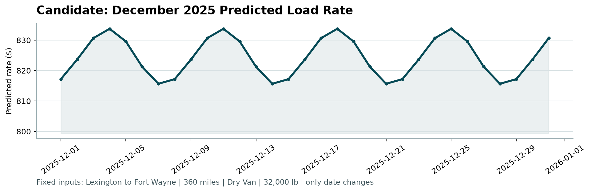

# Freight Rate Prediction

Predicts the **posted rate** of a truckload from its lane, equipment, weight and date.
Trained on Jan–Oct 2025 loads, it prices Nov–Dec 2025, so everything here, from the
data split to model selection, is built around **forecasting forward in time**.

* **Model selection in MLflow**: feature sets, recency weighting, 7 model families and
  an Optuna search per family, all scored on the same out-of-time folds.
* **FastAPI** service with a typed contract, and a **Streamlit** app with EDA, model
  comparison and live pricing. Both run on the same inference code.
* Tests run on a synthetic dataset, so CI never needs the private data.

> **Results**: see [`reports/REPORT.md`](reports/REPORT.md) (also as
> `reports/freight_rate_report.docx`) for the full write-up: EDA, data-quality fixes,
> split design, train-vs-test accuracy of every model, evaluation and the December chart.

<!-- RESULTS:START -->
## Results

Test = the next two months after each training window (3 out-of-time folds, correctly
labelled loads). The Sep-Oct holdout (train Jan-Aug) gives **1.77% MAPE** for the
selected model; with the ~1.4% corrupted labels included, MAPE is 4.2% / MAE $97.

| Model | Train MAPE | Test MAPE | Test MAE | Test R² | Test loads within ±5% |
| --- | --- | --- | --- | --- | --- |
| **Spline GAM (selected)** | 3.25% | 1.86% | $44 | 0.9976 | 96.3% |
| Blend: GAM + LightGBM | 2.79% | 1.90% | $45 | 0.9975 | 96.0% |
| LightGBM (tuned) | 3.12% | 1.96% | $46 | 0.9975 | 95.1% |
| XGBoost (tuned) | 3.11% | 1.97% | $46 | 0.9975 | 95.2% |
| Neural network, MLP (tuned) | 3.25% | 2.02% | $48 | 0.9973 | 95.2% |
| HistGradientBoosting | 2.95% | 2.16% | $51 | 0.9969 | 92.8% |
| Random Forest (tuned) | 1.98% | 2.30% | $54 | 0.9966 | 91.4% |
| $/mile rule of thumb | 4.50% | 3.71% | $80 | 0.9933 | 72.2% |

Train error is *higher* than test error for most models: the training window contains
whole months whose rate level was shifted (January ~5% cheap, June ~4.5% expensive),
which models without calendar features cannot memorise. Random Forest, which can, is
the family that generalises worst. See the report for the full analysis.


<!-- RESULTS:END -->

## Project layout

```text
src/freight_rate/            the ML package
  config.py                  paths, schema, CV folds, selection metric
  data.py                    loading, schema checks, row-level cleaning, quality report
  features.py                FreightFeatures transformer, market calendar, city lookup
  models.py                  ColumnTransformer preprocessing + model zoo + pipeline factory
  validation.py              time folds, metrics, out-of-fold label-noise detection
  train.py                   staged MLflow study, Optuna tuning, final fit, registry
  evaluation.py              holdout segments, diagnostics, inference benchmark
  predict.py                 writes validation_predictions.csv and the December file
  inference.py               FreightRatePredictor: the one inference path for CLI/API/app
  eda.py                     figures + aggregate-only EDA summary
  report.py                  train-vs-test table per model, DOCX + Markdown report
api/
  main.py                    FastAPI app (lifespan model loading, CORS, timing header)
  schemas.py                 Pydantic request/response models
  routers/predictions.py     /api/health, /api/model, /api/predict, /api/predict/batch
app/
  streamlit_app.py           entry point and navigation
  common.py                  embedded-or-remote pricing client, cached artefacts
  views/                     overview, EDA, model comparison, pricing, batch, December
models/
  freight_rate_model.joblib  the fitted pipeline (cleaning -> features -> model)
  model_card.json            what was trained, on what, and how well it scored
reports/                     figures, experiments.csv, evaluation.json, REPORT.md, .docx
tests/                       96 tests: data, features, folds, models, inference, API, pages
Dockerfile                   two-stage build (uv resolve -> slim runtime, non-root)
docker-compose.yml           API + Streamlit (the app prices through the API)
```

## Data

The assessment data and brief are **not** in this repository (see `.gitignore`).
To reproduce the training, place the provided files like this:

```text
data/train_test.csv
data/validation.csv
data/validation_predictions_template.csv
data/december_chart_inputs.csv
score.py                      (the provided scorer)
```

The API, the Streamlit app and the test suite all work without them: they use the
committed model in `models/` and the aggregates in `reports/`.

## Running it

```bash
uv sync                        # Python 3.11, all dependency groups

uv run freight-eda             # figures + reports/eda_summary.json
uv run freight-train           # MLflow study + final model (~1 h; --quick for a smoke run)
uv run freight-predict         # validation_predictions.csv + fills data/december_chart_inputs.csv
python score.py --predictions validation_predictions.csv --december-predictions data/december_chart_inputs.csv
uv run freight-report          # train-vs-test table per model, REPORT.md and the .docx
```

Without uv: `pip install -r requirements.txt` covers the runtime and the scorer.

### MLflow

```bash
uv run mlflow ui --backend-store-uri sqlite:///mlflow.db
```

One parent run per study, one nested run per candidate, tagged by `stage`
(`features`, `recency`, `models`, `tuning`, `checks`). Each run logs its parameters,
the CV metrics, a per-fold CSV and per-fold metric steps, so any two runs can be
compared side by side. The selected pipeline is registered as `freight-rate-model`.

### API

```bash
uv run uvicorn api.main:app --reload       # docs at http://127.0.0.1:8000/docs
```

`POST /api/predict`: only lane, equipment and date are required; anything missing is
filled the way the training pipeline fills it, and reported back.

```json
{ "pickup": "Lexington", "delivery": "Fort Wayne", "equipment": "Dry Van",
  "date": "2025-12-15", "distance": 360, "weight": 32000 }
```

```json
{ "predicted_rate": 818.4, "rate_per_mile": 2.2733, "distance_used": 360.0,
  "imputed_fields": ["pickup_lat", "pickup_lon", "delivery_lat", "delivery_lon",
                     "market_index", "quote_signal"],
  "model_version": "2026-10-01T12:40:00+00:00" }
```

| Endpoint | |
| --- | --- |
| `GET /api/health` | readiness probe (`degraded` instead of failing when the model is missing) |
| `GET /api/model` | estimator, features, training window, CV scores, known cities |
| `POST /api/predict` | one load |
| `POST /api/predict/batch` | up to 5,000 loads in one vectorised call |

Invalid input gets a `422` with a per-field message: unknown equipment, negative
distance, latitude without longitude, identical pickup and delivery, or a city the
model has never seen *and* no coordinates for it.

### Streamlit

```bash
uv run streamlit run app/streamlit_app.py
```

Pages: overview, data exploration, model comparison (every MLflow run, tuning curves,
per-fold and per-segment results, inference speed), price a load, batch CSV pricing,
and the December chart.

The app runs in two modes. With `FREIGHT_API_URL` set, every price comes from the
FastAPI service. Without it (Streamlit Community Cloud, which cannot host a second
process), the same `FreightRatePredictor` runs in-process.

**Deploying to Streamlit Community Cloud:** push this repository to GitHub, then on
share.streamlit.io create an app with main file `app/streamlit_app.py` and Python 3.11.
Dependencies come from `app/requirements.txt`. The EDA page is built from aggregates
only, so no raw load is published.

## Docker

```bash
docker compose up --build      # API on :8000, Streamlit on :8501 (pricing via the API)
```

The image is two-stage: the first stage resolves `uv.lock` (runtime group only, no
MLflow or Optuna) into `/opt/venv` and installs the package; the second copies that
venv into `python:3.11-slim`. `libgomp1` is there for LightGBM/XGBoost. It runs as a
non-root user and declares a `HEALTHCHECK` on `/api/health`.

## Tests

```bash
uv run pytest                                  # 96 tests
uv run pytest --cov=freight_rate --cov=api --cov-report=term-missing
```

* **Data**: every cleaning rule, the quality report, schema errors.
* **Features**: the market calendar only looks backwards, gaps are filled from the
  right day, coordinates come from the city lookup, and every feature set transforms.
* **Validation**: folds never train on the future, test blocks are two months,
  metrics match hand-computed values.
* **Models**: every family fits, predicts positive finite rates, beats a constant,
  round-trips through joblib, and receives the recency weights.
* **Inference & deliverables**: the template order is kept, the December file keeps
  its columns, and the same rules `score.py` enforces are checked.
* **API**: status codes and shapes over real HTTP, a `422` for every invalid case.
* **Streamlit**: every page renders without an exception (`streamlit.testing.AppTest`).

The suite trains on a synthetic dataset with the same schema and defects, so it
passes on a fresh clone and in GitHub Actions without the private data.
