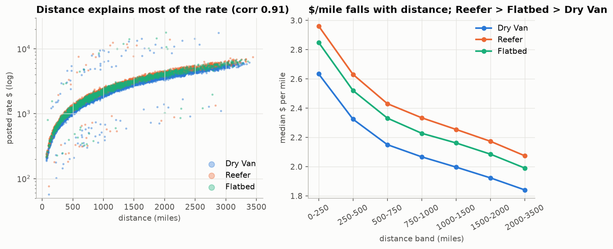
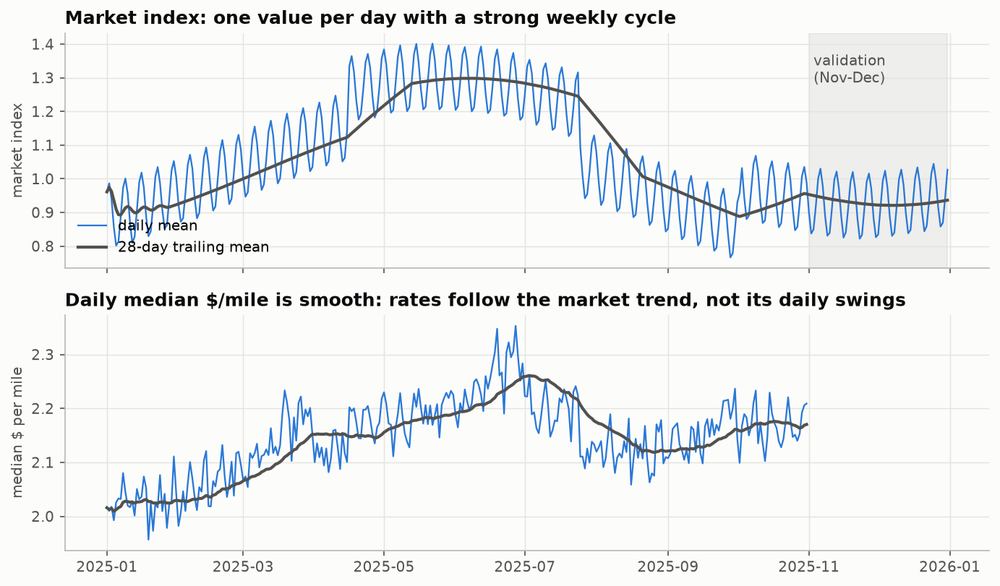
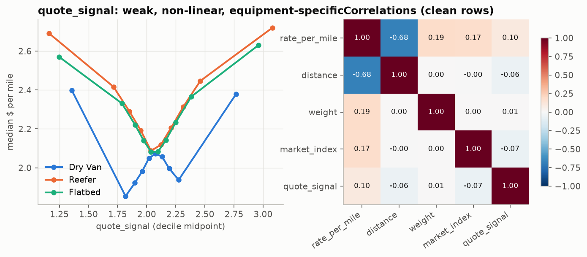
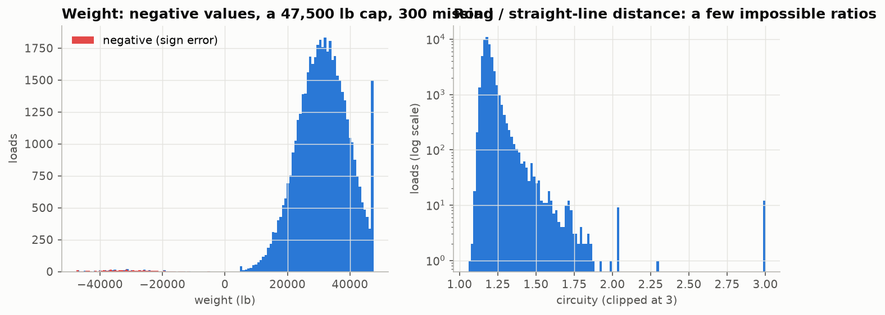
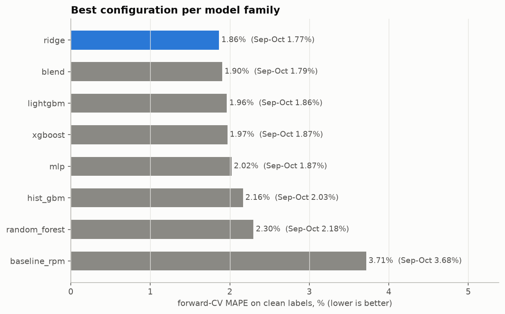
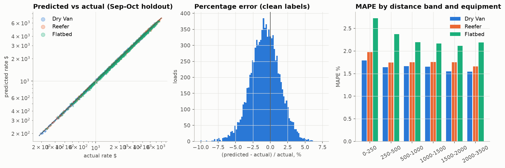

# Freight Rate Prediction: Approach, Validation and Results

Model: Spline GAM (ColumnTransformer: impute, scale, B-splines -> Ridge), feature set 'no_quote', trained on 47,323 loads (2025-01-01 to 2025-10-31). Selected from 97 MLflow-tracked runs.

## 1. Summary

- Out-of-time accuracy (mean of 3 folds, each predicting the next two months): MAPE 1.86%, MAE $44 on correctly labelled loads; 96.3% of loads priced within ±5%.
- Latest fold (train Jan-Aug, predict Sep-Oct, the closest rehearsal of the real task): MAPE 1.77%, R² 0.9980.
- The $/mile rule of thumb scores 3.71% on the same folds, so the model cuts its error by 50%.
- About 677 labels (1.4%) are corrupted (2-5x off). Metrics are reported with and without them; no model can predict them.

## 2. Data exploration: key findings

- 48,000 labelled loads (Jan-Oct 2025) and 12,000 loads to price (Nov-Dec 2025): the task is a two-month forecast, not interpolation.
- Distance explains most of the rate (correlation 0.91). $/mile falls with distance and is highest for Reefer, then Flatbed, then Dry Van.
- market_index is one value per day plus small noise (within-day std 0.025 vs 0.167 across days). It has a weekly cycle on top of a piecewise trend. Rates follow the trend loosely, but the mapping drifts: Sep-Oct rates are ~5% above Jan-Feb at the same market level.
- quote_signal looks irrelevant by correlation (0.10) but has a V-shaped effect whose direction flips from month to month, so it is unstable as a forward-looking signal.
- 1,447 validation loads (12%) touch one of 8 cities that never appear in training (e.g. Chicago, Charlotte, Laredo).


*Rate vs distance and $/mile by equipment*


*Market index and daily $/mile over time*


*quote_signal effect and correlations*

## 3. Data-quality issues and how they were handled

| Issue | Rows | Treatment |
|---|---|---|
| Corrupted posted rates | ~677 rows (1.4%) | Flagged out-of-fold (label vs. prediction from a model that never saw the row, >1.6x off); dropped from training, excluded from 'clean' metrics. |
| Negative weight | 292 | Sign error (same distribution as positives): abs(). |
| Missing weight | 300 | Median weight of the same equipment type, fitted in the pipeline. |
| Missing market_index | 374 | That day's mean market index (error ~0.025 instead of ~0.17 for a global median). |
| Weight at 47,500 lb cap | 1204 | Kept: a legal-maximum cap, not an error. |
| Distance/straight-line > 1.6 | 111 | Road distance kept; the circuity feature is clipped to [0.8, 2.5]. |
| Unseen cities (validation) | 1447 | No city IDs: coordinates, distance and bearing generalise to new cities. |


*Weight and circuity defects*

## 4. Validation approach and data split

Labels end on 31 Oct and the loads to price are in Nov-Dec, so validation must answer one question: how well does a model trained on the past price the next two months? The development data is split by time into three expanding-window folds with a two-month test block, which is the same shape as the real task:

| Train on | Test on |
|---|---|
| Jan-Jun | Jul-Aug |
| Jan-Jul | Aug-Sep |
| Jan-Aug | Sep-Oct |

- Selection metric: mean MAPE over the three folds on correctly labelled loads. MAPE because a $40 miss matters on a $300 load and not on a $6,000 one.
- No random split: the market and quote relationships drift month to month, and only a forward split measures that. (A shuffled 3-fold on the chosen model scores 2.81% vs 1.86% forward. The model has no calendar features, so shuffling mixes every month's level shift into each test fold rather than leaking.)
- Imputation medians and recency weights are fitted inside each fold's training window. Label-noise flags are computed once, out-of-fold over all labelled loads (each load is judged by a model that never saw it), and applied identically to every candidate. The market calendar and city coordinates use feature columns only, never the target.
- Unseen-city rehearsal: hiding 8 cities from training gives 1.74% on loads touching them vs 1.79% on the rest.
- Label-noise filter: training on all labels instead gives 1.97% (vs 1.86%).

## 5. Experiments (MLflow)

Stage 1 compared feature sets under a tree model and an additive model. Every market-index variant and the trend feature lose forward in time, and dropping quote_signal helps both families:

| feature set | LightGBM CV MAPE % | Spline GAM CV MAPE % |
|---|---|---|
| base | 2.792 | 2.181 |
| base_trend | 3.507 | 3.160 |
| full | 3.650 | 4.373 |
| market_raw | 3.321 | 3.829 |
| market_smooth | 3.639 | 4.375 |
| no_quote | 2.133 | 1.886 |

Stage 2 tested recency weighting (half-life 30-240 days). Stage 3 ran the model zoo with defaults. Stage 4 ran an Optuna search per family, every trial a nested MLflow run:

| Family | Optuna trials | Best tuned CV MAPE % | Default CV MAPE % |
|---|---|---|---|
| blend | 12 | 1.903 | 1.922 |
| lightgbm | 12 | 1.962 | 2.133 |
| mlp | 12 | 2.020 | 2.257 |
| random_forest | 12 | 2.308 | 2.297 |
| ridge | 12 | 1.863 | 1.886 |
| xgboost | 12 | 1.969 | 2.168 |

## 6. Models: accuracy on training vs test data

Best configuration per family, refitted on each fold. Train = the rows it was fitted on; Test = the following two months (clean labels). Gap = test minus train MAPE:

| model | Train MAPE % | Test MAPE % | Gap (pts) | Test MAE $ | Test MAE $ (all labels) | Test R² | Test within ±5 % |
|---|---|---|---|---|---|---|---|
| Spline GAM (ColumnTransformer: impute, scale, B-splines -> Ridge) | 3.25 | 1.86 | -1.39 | 44.37 | 97.27 | 1.00 | 96.29 |
| Blend (GAM + LightGBM, log space) | 2.79 | 1.90 | -0.89 | 45.24 | 98.11 | 1.00 | 95.95 |
| LightGBM | 3.12 | 1.96 | -1.16 | 45.81 | 98.70 | 1.00 | 95.08 |
| XGBoost | 3.11 | 1.97 | -1.14 | 45.92 | 98.81 | 1.00 | 95.20 |
| Neural network (MLP, scaled inputs) | 3.25 | 2.02 | -1.23 | 47.84 | 100.69 | 1.00 | 95.16 |
| HistGradientBoosting | 2.95 | 2.16 | -0.79 | 50.65 | 103.45 | 1.00 | 92.84 |
| Random Forest | 1.98 | 2.30 | 0.32 | 53.73 | 106.52 | 1.00 | 91.42 |
| Baseline ($/mile by equipment x distance band) | 4.50 | 3.71 | -0.79 | 80.33 | 132.85 | 0.99 | 72.18 |

Most models score better on the unseen months than on their own training rows. That is not leakage: the training window contains whole months whose rate level was shifted (January about 5% cheap, June about 4.5% expensive), and the models deliberately have no calendar features, so they cannot memorise those month-specific shocks. That error appears in-sample, while the test months sit near the average level. Random Forest is the exception: it fits its training rows far more closely (fully grown trees memorise noise) and is the family that generalises worst. A negative or small gap is the behaviour we want from a model that must price future months.


*Best forward-CV MAPE per model family*

Why Spline GAM (ColumnTransformer: impute, scale, B-splines -> Ridge): it has the lowest error on unseen months, the smallest train-test gap, and the most stable error across folds. The tree ensembles fit the training months more closely but react to every month-specific shift, which does not carry forward. The additive spline model captures the dominant, smooth effects (distance taper, equipment premium, weight, geography) and extrapolates them predictably.

## 7. Selected model: evaluation

| Test months | Train rows | Test rows | MAPE % | MAE $ | R² | Bias $ | MAPE % (all labels) | MAE $ (all labels) |
|---|---|---|---|---|---|---|---|---|
| Jul-Aug | 28406 | 9671 | 2.09 | 50.78 | 1.00 | -18.59 | 4.35 | 102.76 |
| Aug-Sep | 33253 | 9429 | 1.73 | 40.77 | 1.00 | 6.91 | 3.98 | 91.46 |
| Sep-Oct | 37944 | 9523 | 1.77 | 41.55 | 1.00 | -17.47 | 4.29 | 97.58 |

Holdout Sep-Oct: 96.8% of loads within ±5% and 100.0% within ±10%. Error by segment:

| Segment | Loads | MAPE % | MAE $ | Bias $ |
|---|---|---|---|---|
| Dry Van | 5275 | 1.63 | 36.13 | -11.97 |
| Flatbed | 1746 | 2.24 | 53.83 | -31.79 |
| Reefer | 2358 | 1.75 | 44.58 | -19.15 |
| (0, 250] | 544 | 2.00 | 9.78 | -5.89 |
| (1000, 1500] | 1735 | 1.76 | 45.34 | -18.51 |
| (1500, 2000] | 1149 | 1.70 | 61.14 | -24.87 |
| (2000, 3500] | 1513 | 1.69 | 80.58 | -29.69 |
| (250, 500] | 1511 | 1.81 | 17.28 | -10.10 |
| (500, 1000] | 2927 | 1.79 | 29.87 | -13.58 |


*Holdout diagnostics*

## 8. Validation set (Nov-Dec) predictions and inference

All 12,000 loads in validation.csv were priced ($189 to $6,908, median $2,034, no non-positive values) and written to validation_predictions.csv in the template's order. The file has no labels, so its accuracy is measured by the assessor; the folds above are the estimate. Predicted $/mile lines up with the most recent actuals:

| Equipment | Nov-Dec predicted median $/mile | Sep-Oct actual median $/mile |
|---|---|---|
| Dry Van | 2.039 | 2.051 |
| Reefer | 2.297 | 2.318 |
| Flatbed | 2.205 | 2.239 |

Inference: 31.8 ms per single load (p50, full pipeline incl. cleaning and features), 56,497 loads/s in batch.

## 9. December chart (score.py)

Fixed load Lexington to Fort Wayne, 360 miles, Dry Van, 32,000 lb; only the date changes. The chart input has no coordinates or market columns, so coordinates come from the city lookup learned from the data. The model's date sensitivity is the learned day-of-week pattern; it has no month or trend term to extrapolate, by design.


*Generated by the provided score.py*

## 10. Reproducing

```bash
uv sync
uv run freight-eda
uv run freight-train
uv run freight-predict
python score.py --predictions validation_predictions.csv --december-predictions data/december_chart_inputs.csv
uv run freight-report
```
